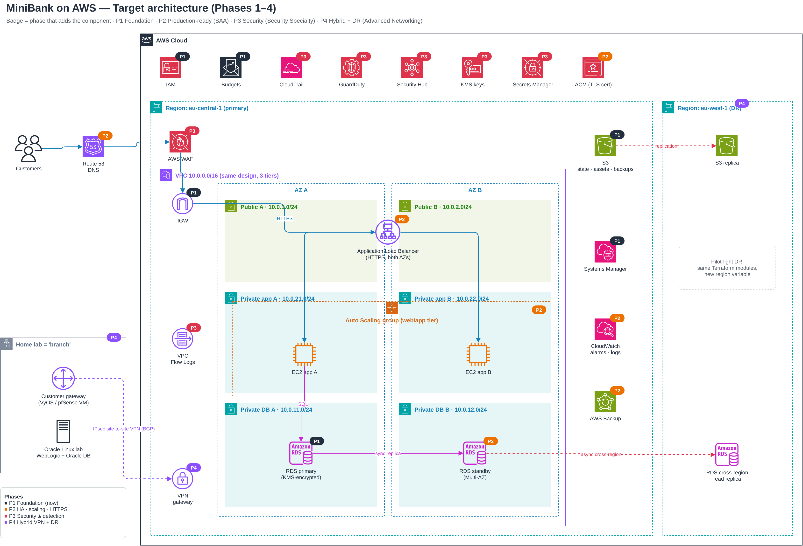

# MiniBank on AWS

A secure, highly available 3-tier "digital bank" platform on AWS, built and tested entirely with **Terraform** and the **AWS CLI**, in phases from foundation to production-ready.



## Why this project
I work in network security and system administration at a bank (firewalls, mail gateways, SWIFT connectivity). This project applies the same principles in the cloud — segmentation, least privilege, high availability, monitoring, cost control — and proves them with real tests, not just diagrams.

## Phases
| Phase | Status | What it adds | Cert focus |
|---|---|---|---|
| 1. Foundation | ✅ Built, tested, destroyed | VPC across 2 AZs, public/private subnets, EC2 + IAM role, private RDS, S3, SSM (no SSH), budget alarm | Cloud Practitioner / SAA |
| 2. Production-ready | ✅ Built, tested, destroyed | Load balancer, Auto Scaling (self-healing), private app tier, S3 gateway endpoint (no NAT), Multi-AZ RDS, CloudWatch alarms → SNS, remote state in S3 with locking | Solutions Architect Associate |
| 3. Bank-grade security | 🔜 | CloudTrail, GuardDuty, Security Hub, KMS, VPC Flow Logs, WAF, Secrets rotation | Security Specialty |
| 4. Hybrid + DR | 🔜 | Site-to-site VPN to a home lab ("branch"), hybrid DNS, DR in a second region, CI pipeline | Advanced Networking |

## Phase 2 architecture (current)
- **Only the load balancer is public.** Web servers run in private subnets with no public IP and no internet route.
- Servers install packages and read S3 through a **free S3 gateway endpoint** instead of a ~$33/month NAT gateway.
- **Security-group chain by identity:** internet → `alb-sg` → `app-sg` → `db-sg` (3306). Rules survive Auto Scaling IP changes.
- **Auto Scaling group** across 2 AZs with ELB health checks and CPU target tracking.
- **RDS MySQL Multi-AZ**, encrypted, password generated and stored in Secrets Manager (never in code or state).
- **IMDSv2**, encrypted disks, private and versioned S3, no SSH keys anywhere.
- **Terraform state** in a versioned, encrypted S3 bucket with native locking (`bootstrap/`).

## Tests performed (with evidence)
| Test | Result | Evidence |
|---|---|---|
| Phase 1 site served by Terraform-built EC2 | ✅ | `docs/screenshots/03` |
| Load balancer spreads traffic across 2 AZs | ✅ | `06`, `07` |
| Private chain: S3 via IAM role + endpoint, DB on 3306 | ✅ | `06` |
| Servers have no public IP | ✅ | `08` |
| Self-healing: terminated a server under traffic → replaced automatically | ✅ | — |
| CloudWatch alarm email on unhealthy host, then OK | ✅ | — |
| Forced Multi-AZ DB failover: primary moved 1b → 1a, same endpoint | ✅ | `09`, `10` |
| Remote state stored in S3 | ✅ | `11` |

## Lessons learned
- **A hard crash still gives ~30 s of 502s** until health checks mark the server unhealthy. Planned removals through the ASG drain first and give zero errors. Health-check interval is a trade-off between detection time and traffic.
- **Browser keep-alive hides load balancing.** A new connection (or a scripted loop) shows the real distribution.
- **Multi-AZ failover is DNS-based:** the endpoint name stays, the private IP changes. The app needs no change.
- **PowerShell splits `-out=file.plan` at the dot** — quote it: `"-out=phase1.plan"`.
- **Destroy every session.** Rebuilding from code takes one command; idle infrastructure costs money.

## Cost discipline
| Phase | ~ per hour while running |
|---|---|
| 1 | $0.04 |
| 2 | $0.11 |
Everything is destroyed after each session; a monthly budget alert emails before the limit is reached.

## Repository layout
```
bootstrap/   one-time S3 bucket for Terraform state
phase1/      foundation (local state)
phase2/      production-ready (remote state)
docs/        architecture diagram (draw.io + PNG) and test screenshots
```
Each phase folder has its own `README.md` runbook: deploy, tests, break-it exercises, destroy, rollback.

## How to run
```
cd bootstrap && terraform init && terraform apply          # once
cd ../phase2
cp terraform.tfvars.example terraform.tfvars               # set your email
terraform init "-backend-config=backend.hcl"
terraform plan "-out=phase2.plan"
terraform apply "phase2.plan"
terraform destroy                                          # end of session
```
Requirements: Terraform ≥ 1.11, AWS CLI v2 configured with an IAM user (not root).

## Security note
No credentials, account IDs, state files or personal tfvars are committed (`.gitignore` in each folder). All addresses are lab-only.
